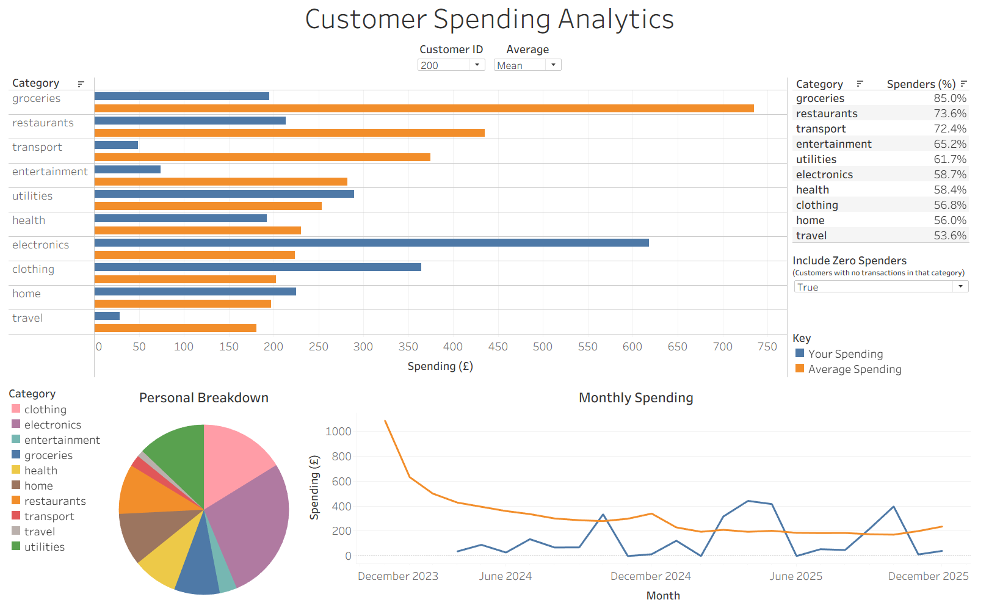

# Customer Spending Analytics

The aim of this project was to build a personalised spending analytics dashboard for account-holding customers using synthetic banking data. The dashboard allows the user to select a specific `Customer ID` and compare that customer's spending to the average spending across all account-holding customers, where "average" can be chosen to be mean or median. SQL was used for handling the data, and the dashboard was created using Tableau.

The general layout of the dashboard is shown below. The full interactive version can be found [here](https://public.tableau.com/app/profile/luaidh.williams/viz/customer_spending_analysis/CustomerSpendingAnalyticsDashboard).

## Dataset

### Structure and Use

The dataset consisted of 5 tables - ``accounts``, ``branches``, ``customers``, ``merchants``, and ``transactions`` - though the ``branches`` and ``customers`` tables remained largely unused throughout the project. Notable features of the other three tables are given below.

| Table    | Details |
| -------- | ------- |
| Accounts | Used to select account-holding customers, as all recorded transactions are linked to an account |
| Merchants | Records information about types of purchase (e.g. groceries, travel) in the `category` field| 
| Transactions | Contains information about all transactions across the two year period from 01/01/2024 to 31/12/2025 |

Every transaction is linked to an account, and most (but not all) transactions are also linked to a merchant.

### Limitations

All data used is synthetic, meaning that the dashboard created is purely for illustrative purposes and no real-world conclusions can be drawn from it.

In the dataset description, it is noted that "a small number of card payments were posted twice" for learning purposes. However, in this project no attempt at identifying and filtering out potential duplicate transactions was made, as the main goal was to construct a clear dashboard after performing exploratory SQL analysis. These duplicates may affect the results of spending analyses.

The original dataset was obtained from SQLShed. It is licensed under [CC0 1.0](https://creativecommons.org/publicdomain/zero/1.0/) and can be found [here](https://sqlshed.com/practice-datasets/banking-transactions/).

## Structure and Goals

The project can be split up into two main parts.

The first part is about comparing an individual customer's spending by ``merchant`` category to those of the average customer.

The second part is about comparing an individual customer's monthly spending to that of the average customer.

## Methodology and Assumptions

### Spending and Averages

Since this project was concerned with analysing customer spending, only debit transactions were considered.

A brief exploration of the dataset reveals that a few customers correspond to an extremely large proportion of money spent across all transactions, and hence the mean of all spending in a particular category/month differs greatly from the median. This may reflect reality, but it may also partly be an unintentional byproduct from how the data was generated. For this reason, the user is given the option of selecting between mean and median as their choice of average.

### Currency Conversion
The original dataset contains transactions in three different currencies: GBP, USD, and EUR. In order to perform consistent spending analysis, all transactions were first converted to GBP. This was done using a flat conversion constant rather than factoring in changes in exchange rate across the two year period. The constants used were based roughly on the true average exchange rates across that period and are given below.

| Currency    | Conversion Constant |
| -------- | ------- |
| GBP | 1 |
| USD | 0.77 | 
| EUR | 0.85 |

### Spending by Category
Since not every debit transaction is linked to a merchant (e.g. ATM withdrawals), the category-level analysis does not reflect the full spending activity of a given customer. Rather, the analysis in this section is restricted to transactions tied to merchants.

Since there are many customers who did not spend any money in a given category, the "Include Zero Spenders" parameter was added to the dashboard. This gives the user the option of comparing a selected customer's spending by category against either all customers, or just those who spent money in a given category. In particular, if zero spenders are excluded then the population that average spending is calculated over differs from category to category. The proportion of customers who spent in a given category is given in a table in the dashboard.

### Monthly Spending
The transactions in the dataset cover the two year period from 01/01/2024 to 31/12/2025, but the number of customers with an active account in a given month varies across this period. Since only customers with an active account can spend money, in order for the average metrics to be fair, monthly averages were calculated only using customers who had at least one account open at some point in that month, even if it wasn't open for the whole month.

For months where the selected customer had no active accounts, the monthly spending graph simply displays no value for that month. This means it is possible for the monthly spending graph of a given customer to be broken across more than one continuous line (see, for example, the customer whose `Customer ID` is 530).

## Potential Improvements

A few suggestions for directions to take the project in are given below:

- Implement a duplicate transaction checker and allow the user to toggle whether suspicious transactions should be included in the analysis.
- Use historical data on exchange rates rather than simple constants to make conversion calculations more accurate.
- Add further dashboard data and/or visualisations. For example, add a feature that displays the balance in each of the selected customer's open accounts, or one that summarizes their most recent transactions.

## How to Reproduce the Analysis

### Requirements

- DuckDB for running SQL scripts
- Tableau Desktop for viewing the dashboard
- The source data files in the `data` folder

### The SQL Files

- `sql/00_setup.sql` creates the views used in the rest of the analysis.
- `sql/01_spending_breakdown.sql` and `sql/02_monthly_spending.sql` contain queries that were used to extract relevant information during the SQL analysis phase of the project, but were not used in making the dashboard.
- `sql/03_export.sql` creates CSV files corresponding to the two main analytical views, which are what Tableau interacts with.

To set the analysis up, run `sql/00_setup.sql` and then `sql/03_export.sql` in DuckDB before opening the Tableau workbook.